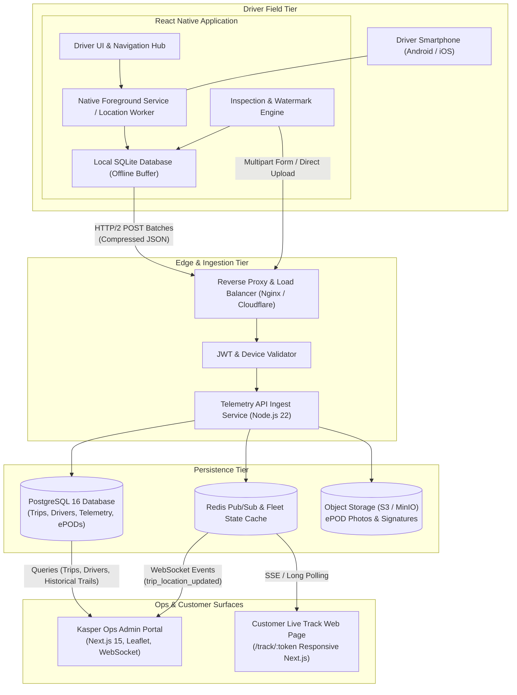
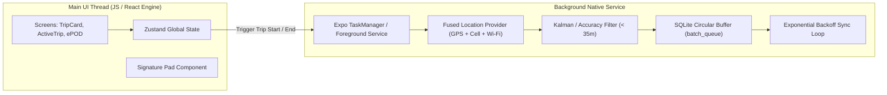
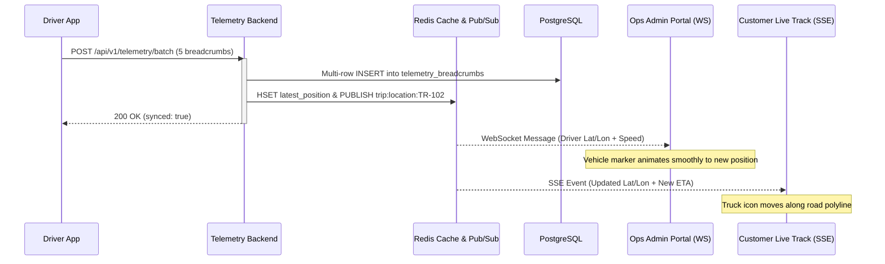

# System Architecture Document
## Project: Kasper Driver & Dispatch Telemetry Ecosystem

---

## 1. System Topology & Component Layout



---

## 2. Driver Mobile App Architecture (`/apps/mobile-driver`)

### 2.1 The Two-Process Mobile Architecture
On modern mobile operating systems (especially Android 13+ with battery optimizations and aggressive manufacturer Doze rules from Samsung, Xiaomi, and Huawei), background geolocation must run cleanly detached from React component lifecycles.



### 2.2 Adaptive Sampling Algorithm (State-Based)

To achieve the 5% battery consumption target while preserving crisp breadcrumb maps, the mobile app dynamically throttles the GPS chip and radio hardware:

```typescript
interface LocationSamplingPolicy {
  minIntervalMs: number;
  minDistanceMeters: number;
  fastestIntervalMs: number;
}

function calculateSamplingPolicy(currentSpeedKmh: number, batteryPct: number): LocationSamplingPolicy {
  // Thermal / Low Battery Protection Fallback
  if (batteryPct < 15) {
    return { minIntervalMs: 45000, minDistanceMeters: 100, fastestIntervalMs: 30000 };
  }

  // High Speed Highway Transport (> 50 km/h)
  if (currentSpeedKmh > 50) {
    return { minIntervalMs: 10000, minDistanceMeters: 50, fastestIntervalMs: 5000 };
  }

  // City Driving & Congestion (15 - 50 km/h)
  if (currentSpeedKmh >= 15 && currentSpeedKmh <= 50) {
    return { minIntervalMs: 15000, minDistanceMeters: 25, fastestIntervalMs: 10000 };
  }

  // Crawling or Yard Maneuvers (2 - 15 km/h)
  if (currentSpeedKmh > 2 && currentSpeedKmh < 15) {
    return { minIntervalMs: 20000, minDistanceMeters: 10, fastestIntervalMs: 15000 };
  }

  // Stationary / Stopped / Staging (< 2 km/h)
  return { minIntervalMs: 60000, minDistanceMeters: 0, fastestIntervalMs: 45000 };
}
```

### 2.3 Local Offline Storage Architecture
The mobile client uses `expo-sqlite` to maintain two local tables:

1. **`offline_breadcrumbs`**:
   - `id` (INTEGER AUTOINCREMENT)
   - `trip_id` (TEXT)
   - `latitude` (REAL)
   - `longitude` (REAL)
   - `speed` (REAL)
   - `bearing` (REAL)
   - `accuracy` (REAL)
   - `altitude` (REAL)
   - `battery_level` (INTEGER)
   - `recorded_at` (INTEGER ms)
   - `synced` (INTEGER: 0 = pending, 1 = synced)

2. **`offline_events`**:
   - `id` (INTEGER)
   - `trip_id` (TEXT)
   - `event_type` (TEXT: `STATUS_CHANGE`, `INSPECTION_PHOTO`, `EPOD_SIGNATURE`)
   - `payload_json` (TEXT)
   - `synced` (INTEGER)

The **Sync Worker** runs every 20 seconds. It fetches up to 50 unsynced breadcrumbs, compresses them into a single HTTP POST request, and upon receiving HTTP 200/201, marks them `synced = 1` or removes them to free up device storage.

---

## 3. Backend & Telemetry Ingestion Architecture (`/services/telemetry-api`)

### 3.1 Throughput & Low Latency Design
- Built on Node.js 22 with native HTTP keep-alive, streaming body parsers, and connection pooling (`pg-pool`).
- **Batch Endpoint:** `/api/v1/telemetry/batch` handles up to 100 location points per payload in a single multi-row `INSERT` statement.
- **In-Memory Fleet Cache (Redis):** As soon as a position arrives, the server updates an in-memory hash: `HSET fleet:drivers <driver_id> <latest_json>` and `HSET fleet:trips <trip_id> <latest_json>`, then publishes to `trip_updates:<trip_id>`. This allows the Admin Portal and Customer Tracking page to receive instant updates without hammering the relational database.

### 3.2 Real-Time Distribution Matrix



---

## 4. Standalone Ops Admin Portal Architecture (`/apps/ops-admin`)

### 4.1 Surface Overview
- **Framework:** Next.js 15 (App Router), Tailwind CSS v4, Lucide Icons.
- **Mapping Engine:** Leaflet + Leaflet Rotated Marker (for bearing arrows) + Polyline Decorator.
- **State Management:** Zustand for UI state + React Query / SWR for polling fallback and server data caching.
- **Live Connection:** WebSocket client with automatic reconnection logic.

### 4.2 Core Screens & Modules:
1. **Live Dispatch & Map Command Center (`/dashboard`)**:
   - Split screen: 65% interactive map with clustered fleet markers, 35% scrollable active trips feed.
   - Quick filters: `All Active`, `Delayed`, `Moving`, `At Site`.
   - Click any truck to snap camera, highlight route polyline, and show driver contact card.
2. **Trip Dispatcher (`/trips`)**:
   - Kanban board: Columns representing trip states.
   - New Trip Modal: Autocomplete addresses via Nominatim / Google Places, geofence radius slider (100m to 1000m), cargo weight and type selector.
3. **Driver & Fleet Management (`/drivers`)**:
   - Driver directory, phone numbers, active status, currently assigned truck plate, compliance expiry dates.
4. **ePOD Audit Vault (`/epod-vault`)**:
   - List of all completed deliveries.
   - Inspect high-resolution pre-trip and post-trip photos, signature vector, receiver name, and download signed PDF Consignment Note.

---

## 5. Customer Live Tracking Surface (`/apps/customer-tracking`)

### 5.1 Architecture & Security Rules
- **No Login Barrier:** Secured strictly via cryptographically random 32-character tokens:
  `https://kasper.ae/track/7e3b9a14c82d491f0a5e82b71946dc31`
- **Rate Limiting:** IP-based rate limiting (Cloudflare / Nginx: max 60 req/min per IP) to prevent denial-of-service or scraping.
- **Data Minimization (Privacy Guard):**
  The endpoint strictly filters out:
  - Driver's private personal phone number (replaced with a central Kasper Ops hotline: `+971 4 XXX XXXX`).
  - Driver's historical telemetry before the moment cargo was loaded.
  - Driver's battery level or phone hardware data.
- **ETA Computation Engine:**
  Calculates remaining driving time using road distance divided by active average speed, with a 15% traffic congestion buffer.

---

## 6. Security, Storage & Compliance Standards

1. **Authentication Flow:**
   - **Drivers:** Phone OTP verified via backend ➔ returns signed JWT containing `driver_id` and `tenant_id`. Header: `Authorization: Bearer <jwt>`.
   - **Dispatchers / Admins:** Standard email/password or SSO ➔ session JWT with `role: "ops_admin"`.
   - **Customers:** Unauthenticated token lookup with 48-hour expiration after trip completion.
2. **Object Storage Hierarchy (S3):**
   ```
   kasper-telemetry-vault/
   ├── inspections/
   │   └── {trip_id}/
   │       ├── pre_trip_cargo_01_{timestamp}.jpg
   │       └── post_trip_site_01_{timestamp}.jpg
   └── signatures/
       └── {trip_id}/
           └── epod_signature_{timestamp}.png
   ```
3. **Immutability Assurance:**
   All position records, trip transitions, and signed ePOD attachments are append-only. No `UPDATE` or `DELETE` API endpoints exist for historical telemetry.
