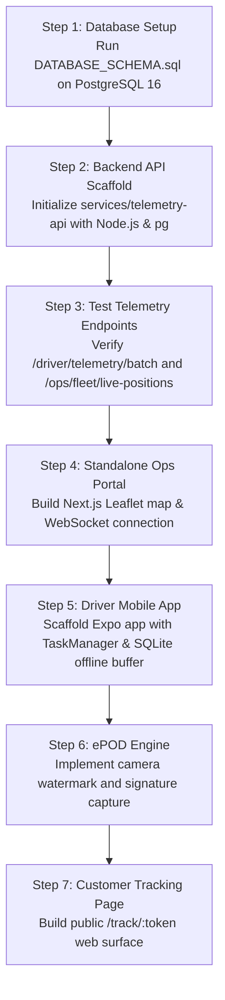

# BUILD_HANDOFF.md: Kasper Driver Ecosystem & Telematics Platform
**Handoff Date:** 2026-11-02  
**Target Repository / Workspace:** `C:\Users\HP\Desktop\antigravity\kasper-driver-ecosystem`  
**Target Platform:** UAE Construction Logistics, Heavy Equipment Transport & Freight  

---

## 1. Project Overview & Context

This folder contains the complete, production-grade architecture, database DDL, API contracts, and requirements for the **Kasper Driver & Dispatch Telemetry Ecosystem**.

### Why This Exists:
1. **No Hardware Dependency:** Eliminates the need to install hardwired Teltonika GPS boxes on third-party contractor trucks. Drivers use their own phones (Android / iOS).
2. **Decoupled & Standalone:** Operates with its own database and ingestion server. It **does NOT depend** on legacy marketplace backends or old ASP.NET Core services.
3. **Trip-Gated Privacy:** The mobile app only streams background GPS when a job is active (`START_TRIP` to `COMPLETE_EPOD`).
4. **Offline Resilient:** Designed for remote UAE desert sites, port freezones, and industrial yards with intermittent cell signal.

---

## 2. Document Map (All in this Folder)

| File | Purpose | Who Uses It |
| :--- | :--- | :--- |
| **[`CLAUDE.md`](file:///C:/Users/HP/Desktop/antigravity/kasper-driver-ecosystem/CLAUDE.md)** / **[`AGENTS.md`](file:///C:/Users/HP/Desktop/antigravity/kasper-driver-ecosystem/AGENTS.md)** | Master developer rules, tech stack constraints, directory tree, run commands. | All AI agents & developers |
| **[`PRD.md`](file:///C:/Users/HP/Desktop/antigravity/kasper-driver-ecosystem/PRD.md)** | Product Requirements Document: Personas, full trip lifecycle, functional specs, UAE operational edge cases. | Product Managers & QA |
| **[`ARCHITECTURE.md`](file:///C:/Users/HP/Desktop/antigravity/kasper-driver-ecosystem/ARCHITECTURE.md)** | End-to-end technical schematics, dual-process mobile tracking model, adaptive GPS sampling, Redis fan-out. | System & Mobile Architects |
| **[`MODULES.md`](file:///C:/Users/HP/Desktop/antigravity/kasper-driver-ecosystem/MODULES.md)** | Granular engineering blueprint for all 8 core modules with implementation code patterns. | Backend & App Developers |
| **[`API_SPEC.md`](file:///C:/Users/HP/Desktop/antigravity/kasper-driver-ecosystem/API_SPEC.md)** | Complete REST & WebSocket API specification (request/response models, auth, payloads). | Backend & Frontend Engineers |
| **[`DATABASE_SCHEMA.sql`](file:///C:/Users/HP/Desktop/antigravity/kasper-driver-ecosystem/DATABASE_SCHEMA.sql)** | Complete PostgreSQL 16+ DDL script: tables, indexes, views, and ready-to-test seed data. | DBAs & Backend Engineers |

---

## 3. Four Core Applications to Build

```
kasper-driver-ecosystem/
├── apps/
│   ├── mobile-driver/        # React Native / Expo Mobile App
│   ├── ops-admin/            # Next.js 15 Dispatch & Live Fleet Map Portal
│   └── customer-tracking/    # Tokenized Live Tracking Web Page (/track/:token)
└── services/
    └── telemetry-api/        # Node.js 22 + PostgreSQL Ingestion & WebSocket Gateway
```

### Component A: Mobile Driver App (`apps/mobile-driver`)
- **Stack:** Expo SDK 52+ (Managed / Prebuild), TypeScript, NativeWind v4, `expo-location`, `expo-task-manager`, `expo-sqlite`, `react-native-signature-canvas`.
- **Primary Screens:**
  1. *Phone OTP Login Screen* (Language selector: EN / AR / UR).
  2. *Assigned Trip Card Screen* (Cargo specs, pickup/drop coordinates, site contacts).
  3. *Active Trip Navigation Hub* (Big action buttons: `Start to Pickup`, `Arrived`, `In Transit`, `Arrived Site`).
  4. *Pre-Trip Inspection Screen* (Camera with timestamp/GPS watermark overlay).
  5. *ePOD Signoff Screen* (Canvas signature pad, receiver full name, designation, phone).
- **Critical Technical Detail:**
  Must use an Android **Foreground Service** with a persistent notification ("*Kasper Transport Active*") so background location is never killed by Android Doze mode or phone overheating.

### Component B: Ingestion & Telemetry API (`services/telemetry-api`)
- **Stack:** Node.js 22 (ESM), Express or Fastify, `pg` (PostgreSQL client), `ws` or Socket.IO, Redis.
- **Key Responsibilities:**
  1. Accept batches of coordinates from mobile devices (`POST /api/v1/driver/telemetry/batch`).
  2. Batch insert coordinates into `telemetry_breadcrumbs`.
  3. Cache latest position in Redis and publish events over WebSocket (`TRIP_LOCATION_UPDATE`).
  4. Handle OTP authentication and photo/signature uploads to S3/MinIO.

### Component C: Standalone Ops Admin Portal (`apps/ops-admin`)
- **Stack:** Next.js 15 (App Router), Tailwind CSS v4, Leaflet / `react-leaflet`, Zustand.
- **Primary Views:**
  1. *Live Dispatch Map (`/dashboard`):* Split view showing all active trucks on a UAE map with rotating directional bearing icons, speed pills, and connection health flags (`LIVE`, `DELAYED`, `OFFLINE`).
  2. *Trip Dispatch Board (`/trips`):* Create new transport requests, pick origin/destination coordinates on map, assign driver.
  3. *Driver Directory (`/drivers`):* Driver availability, vehicle plate numbers, and contact details.
  4. *ePOD Archive (`/epod-vault`):* Inspect digital signatures, before/after photos, and download branded Consignment Note PDFs.

### Component D: Customer Live Tracking Web Page (`apps/customer-tracking`)
- **Stack:** Next.js / React (Lightweight, zero-login, mobile-optimized).
- **URL Format:** `https://kasper.ae/track/:tracking_token`
- **Features:**
  - Real-time map with animated vehicle marker.
  - Dynamic ETA banner calculated from distance and current speed.
  - Status stepper: `Dispatched` ➔ `In Transit` ➔ `Arrived at Site` ➔ `Delivered`.
  - Privacy shield: Never displays driver personal phone number or history prior to pickup.

---

## 4. Step-by-Step Implementation Sequence

Any developer or AI agent should execute in this exact order:



### Fast Verification Checklist:
- [ ] Database seeded: Run `SELECT * FROM v_active_fleet_status;` and see the sample truck `KSP-TR-2041`.
- [ ] Backend health check returns `200 OK`.
- [ ] Sending 3 sample coordinates via `POST /api/v1/driver/telemetry/batch` immediately updates the vehicle icon on the Ops Admin map without browser refresh.
- [ ] Opening `http://localhost:3000/track/8f92a1c0d4e740b2a3f912cd4e019a82` displays the live truck on the customer page.

---

## 5. Contact & Rules Reminder

- **Repository Root:** `C:\Users\HP\Desktop\antigravity\kasper-driver-ecosystem`
- **Do not invent arbitrary backend shapes:** Always match `API_SPEC.md` and `DATABASE_SCHEMA.sql`.
- **Do not bypass local offline storage in mobile:** Always write breadcrumbs to SQLite before pushing to network.
