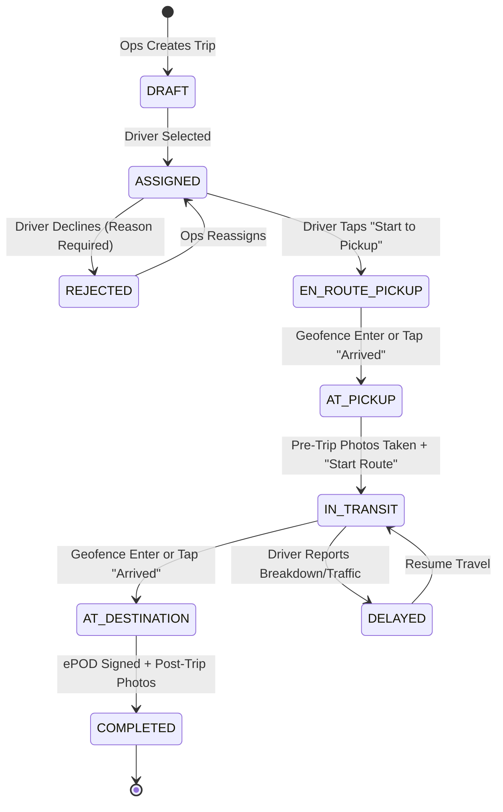

# Detailed Module Breakdown
## Project: Kasper Driver & Dispatch Telemetry Ecosystem

This document specifies each core functional module across the mobile application, ingestion backend, and ops admin portal.

---

## Module Index

- **Module 1:** Driver Authentication & Device Enrollment
- **Module 2:** Trip Lifecycle State Machine (Mobile & Backend)
- **Module 3:** Background Location & Adaptive Throttling Engine
- **Module 4:** Offline Circular Buffer & Sync Engine
- **Module 5:** Telemetry Ingestion Gateway & Fleet Cache
- **Module 6:** Digital ePOD & Visual Inspection Engine
- **Module 7:** Standalone Ops Dispatch Portal & Fleet Map
- **Module 8:** Customer Live Tracking Link & Dynamic ETA Engine

---

## Module 1: Driver Authentication & Device Enrollment

### Purpose
Low-friction driver login that does not require remembering complex alphanumeric passwords. Field drivers frequently switch devices or reinstall apps.

### Key Workflows:
1. **Request OTP (`POST /api/v1/auth/request-otp`)**:
   - Driver enters UAE mobile number (e.g. `+971 50 123 4567`).
   - Server validates format, generates 6-digit numeric OTP with 5-minute TTL, and dispatches via SMS / WhatsApp.
2. **Verify OTP (`POST /api/v1/auth/verify-otp`)**:
   - Driver enters OTP.
   - Server validates against Redis store.
   - If driver exists, returns JWT (`sub: driver_id`, `role: driver`, `exp: 30d`) and driver profile.
   - If driver does not exist, registers new unverified driver profile for Ops verification.
3. **Device Token Enrollment (`POST /api/v1/auth/device-enroll`)**:
   - Registers Expo Push Token (`ExponentPushToken[...]`), device model, and OS version for instant trip dispatch alerts.

---

## Module 2: Trip Lifecycle State Machine

### Purpose
Guarantees sequential progression of logistics delivery phases without missing steps. Both the mobile app and backend enforce this deterministic state machine.

### State Diagram



### State Guard Rules:
- `EN_ROUTE_PICKUP` triggers the start of the background GPS location engine.
- Transition from `AT_PICKUP` to `IN_TRANSIT` requires at least **1 pre-trip inspection photo**.
- Transition from `AT_DESTINATION` to `COMPLETED` requires **receiver name, contact number, signature vector, and at least 1 site photo**.
- Upon reaching `COMPLETED`, background GPS immediately terminates and unregisters the foreground service.

---

## Module 3: Background Location & Adaptive Throttling Engine

### Purpose
Capture high-fidelity vehicle coordinates while operating inside a pocket or vehicle cradle without triggering OS kills or draining the battery during a 10-hour shift.

### Implementation Blueprint (`/apps/mobile-driver/src/services/LocationManager.ts`):
```typescript
import * as Location from 'expo-location';
import * as TaskManager from 'expo-task-manager';
import { bufferPositionLocally } from './OfflineBuffer';

export const LOCATION_TASK_NAME = 'KASPER_BACKGROUND_LOCATION_TRACKER';

export async function startTripTracking(tripId: string) {
  // 1. Request Foreground & Background Permissions
  const { status: fgStatus } = await Location.requestForegroundPermissionsAsync();
  if (fgStatus !== 'granted') throw new Error('Foreground location permission denied');

  const { status: bgStatus } = await Location.requestBackgroundPermissionsAsync();
  if (bgStatus !== 'granted') throw new Error('Background location permission denied');

  // 2. Start Background Location Task with Persistent Android Notification
  await Location.startLocationUpdatesAsync(LOCATION_TASK_NAME, {
    accuracy: Location.Accuracy.High,
    timeInterval: 10000,          // 10s base
    distanceInterval: 30,          // 30 meters
    deferredUpdatesInterval: 20000,
    showsBackgroundLocationIndicator: true,
    foregroundService: {
      notificationTitle: "Kasper Transport Active",
      notificationBody: "Live tracking active for current transport trip.",
      notificationColor: "#FFC400",
    },
  });
}

// Background Task Handler registered outside React components
TaskManager.defineTask(LOCATION_TASK_NAME, async ({ data, error }) => {
  if (error) return console.error('Location task error:', error);
  if (data) {
    const { locations } = data as { locations: Location.LocationObject[] };
    for (const loc of locations) {
      // Accuracy filter: discard noisy multi-path reflections
      if (loc.coords.accuracy && loc.coords.accuracy > 40) continue;
      
      await bufferPositionLocally({
        latitude: loc.coords.latitude,
        longitude: loc.coords.longitude,
        speed: Math.max(0, (loc.coords.speed || 0) * 3.6), // Convert m/s to km/h
        bearing: loc.coords.heading || 0,
        accuracy: loc.coords.accuracy || 0,
        altitude: loc.coords.altitude || 0,
        timestamp: loc.timestamp,
      });
    }
  }
});
```

---

## Module 4: Offline Circular Buffer & Sync Engine

### Purpose
UAE logistics frequently crosses remote stretches (E11 towards Ghuwaifat, desert bypasses, underground port checkpoints) where mobile connectivity drops.

### Sync Engine Blueprint:
1. **Buffering:** When `bufferPositionLocally()` is called, it writes the breadcrumb into SQLite `offline_breadcrumbs` with status `pending`.
2. **Periodic Worker:** A light timer runs every 25 seconds:
   - Queries `SELECT * FROM offline_breadcrumbs WHERE synced = 0 ORDER BY recorded_at ASC LIMIT 50`.
   - If array is empty, worker idles.
   - If items exist, sends `POST /api/v1/telemetry/batch`.
   - On response `200 OK`, executes `DELETE FROM offline_breadcrumbs WHERE id IN (...)` to prevent unbounded SQLite growth.
3. **Backoff on Failure:** If network fails (HTTP timeout or NetInfo reports disconnected), wait `min(60s, 2^retries * 5s)` before retrying.

---

## Module 5: Telemetry Ingestion Gateway & Fleet Cache

### Purpose
Ingest high-frequency JSON coordinate batches, write them durably to PostgreSQL, and fan out the latest coordinates to Redis for real-time consumers.

### Ingestion Pipeline:
1. **Endpoint:** `POST /api/v1/telemetry/batch`
2. **Batch Payload Structure:**
   ```json
   {
     "tripId": "tr_99182",
     "driverId": "drv_441",
     "deviceBattery": 78,
     "samples": [
       {
         "lat": 24.9852,
         "lon": 55.0812,
         "speed": 62.4,
         "bearing": 180.2,
         "accuracy": 5.1,
         "recordedAt": 1730556000000
       }
     ]
   }
   ```
3. **Database Write:**
   Uses PostgreSQL multi-row `INSERT INTO telemetry_breadcrumbs (...) VALUES (...)` wrapped in a fast single transaction.
4. **Cache & Fan-Out:**
   - `HSET fleet:live_positions <driver_id> <latest_payload>`
   - `PUBLISH channel:trip:<trip_id> <latest_payload>`

---

## Module 6: Digital ePOD & Visual Inspection Engine

### Purpose
Eliminates freight damage disputes and manual paper delivery notes with verifiable photo proof and digital signoffs.

### ePOD Components:
1. **Pre-Trip Condition Photos:**
   - Captured via `expo-camera` at the loading yard.
   - Watermark applied on-device: Date, Time, GPS Lat/Lon, Trip Code.
2. **Post-Trip Site Photos:**
   - Photos of machine safely unloaded and placed at client site.
3. **Digital Signature Pad:**
   - Clean, full-width canvas component generating base64 PNG vector.
   - Mandatory signee metadata: `Recipient Full Name`, `Designation / Title`, `Mobile Number`.
4. **Consignment Note PDF Generation:**
   - Backend auto-assembles all photos, timestamps, signatures, and addresses into a branded PDF stored in S3 and downloadable from the Ops Portal.

---

## Module 7: Standalone Ops Dispatch Portal & Fleet Map

### Purpose
Provide dispatchers with situational awareness across all active trips in the UAE.

### Core Views:
1. **Live Map View (`/dashboard`)**:
   - Interactive Leaflet map with custom vehicle icons that rotate based on vehicle bearing.
   - Real-time updates delivered via WebSocket without page refreshes.
   - Geofence visualization: 300-meter translucent circles around pickup and destination coordinates.
2. **Trip Management (`/trips`)**:
   - Filter by status: `Draft`, `Assigned`, `En Route`, `Delivered`.
   - "New Trip" creation drawer with coordinates picker and distance estimator.
   - "Generate Customer Link" button with instant WhatsApp copy template.
3. **Driver Directory (`/drivers`)**:
   - Active status indicator (Online / On Trip / Offline).
   - Driver phone number, vehicle plate, license category, and recent trip history.

---

## Module 8: Customer Live Tracking Link & Dynamic ETA Engine

### Purpose
Offer end clients an Uber-like live map experience for their equipment transport without requiring them to download an app or log in.

### Technical Workflow:
1. When a trip transitions to `EN_ROUTE_PICKUP` or `IN_TRANSIT`, Ops clicks "Share Tracking Link".
2. Link format: `https://kasper.ae/track/:tracking_token`
3. Web page loads a responsive map (Leaflet) that:
   - Fetches trip metadata: Origin, Destination, Cargo Name, Vehicle Category.
   - Connects to Server-Sent Events (SSE) or polls `/api/v1/public/track/:token` every 5 seconds.
   - Animates vehicle marker along the road.
   - Calculates and displays dynamic ETA:
     $$\text{ETA} = \text{Current Time} + \left( \frac{\text{Remaining Distance (km)}}{\text{Average Speed (km/h)}} \times 1.15 \right)$$
   - Updates status pills: `Dispatched` ➔ `In Transit` ➔ `Arrived at Site` ➔ `Delivered`.
   - Once delivered, displays the signed delivery timestamp and completed confirmation.
