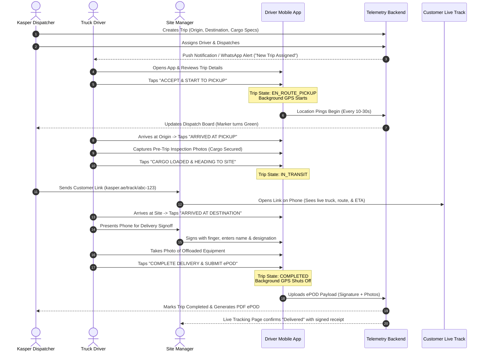

# Product Requirements Document (PRD)
## Project: Kasper Driver Ecosystem & Telemetry Dispatch Platform
**Version:** 1.0  
**Status:** Approved for Implementation  
**Target Market:** UAE Heavy Equipment, Construction Logistics & Freight  

---

## 1. Executive Summary & Problem Statement

### 1.1 The Problem
In industrial and construction logistics (equipment rental moves, low-bed transport, flatbed cargo, aggregate haulage):
1. **Blind Spots in Transit:** Once heavy equipment or flatbed trucks leave the yard or supplier warehouse, neither the dispatch team nor the customer has real-time visibility into vehicle location or delivery ETA.
2. **Hardware Tracker Bottlenecks:** Installing dedicated hardwired GPS units (such as Teltonika devices) across sub-contractor fleets and ad-hoc haulers is costly, logistically slow, and often impossible for third-party vehicle pools.
3. **Delivery Disputes & Damage Claims:** Paper Delivery Notes (DN) get lost, grease-stained, or illegible. When equipment arrives scratched or damaged, clients claim the damage occurred during transport, while haulers claim it was already present upon loading.
4. **Driver Disconnect:** Drivers frequently communicate via informal WhatsApp voice notes while driving, leading to distracted driving and missed gate coordinates.

### 1.2 The Solution
The **Kasper Driver Ecosystem** transforms the driver's smartphone into an intelligent, enterprise-grade telematics beacon, trip navigator, and electronic Proof of Delivery (ePOD) terminal:
- **Zero Hardware Installation:** Deployed as a lightweight app on Android and iOS devices.
- **Trip-Gated Privacy:** Location tracking runs exclusively between dispatch pickup and site delivery sign-off, protecting driver privacy off-duty.
- **Standalone Ops Dispatch Portal:** A purpose-built command center where operators create loads, assign drivers, monitor live truck trails, and respond to delays.
- **Customer Live Tracking Links:** One-click, unauthenticated live tracking web links sent to customers via SMS or WhatsApp, featuring real-time maps and dynamic ETAs without requiring account creation.
- **Defensible Digital ePOD:** Photographic inspection and capacitive digital signatures with GPS/time-watermarks, creating an indisputable audit trail.

---

## 2. User Personas

### Persona A: Rashid (The Transport Driver)
- **Role:** Flatbed / Lowbed truck driver.
- **Environment:** Driving 10-12 hours daily across Dubai, Abu Dhabi, Sharjah, and remote industrial/oilfield sites (e.g., Al Ruwais, ICAD, JAFZA).
- **Tech Fluency:** Moderate. Primary language is Urdu or Arabic; struggles with complex English enterprise forms. Uses WhatsApp and Google Maps daily.
- **Needs:** Big buttons, fast one-tap status updates, crystal-clear pickup/drop-off pins, and zero battery drain or device freezing in 45°C summer heat.

### Persona B: Tarek (The Ops Controller & Fleet Dispatcher)
- **Role:** Logistics Coordinator at Kasper Ops desk.
- **Needs:** Centralized map showing all active trips, real-time alert feed (delays, off-route deviations, long stops), ability to reassign drivers, and one-click sharing of live tracking links with anxious site project managers.

### Persona C: Engineer Farhan (The Client Site Manager)
- **Role:** Receiving Site Engineer at a megaproject (e.g., Dubai South).
- **Needs:** Knowing exactly when the 50-ton excavator will arrive so mobile cranes and rigging teams are not standing idle billing hourly demurrage. Wants a simple WhatsApp link to track the truck in real time.

---

## 3. Product Workflows & User Journeys

---

## 4. Functional Requirements

### 4.1 Driver Mobile App (`mobile-driver`)

#### FR-1: Authentication & Driver Onboarding
- **FR-1.1:** Passwordless authentication via Mobile Number + SMS/WhatsApp OTP.
- **FR-1.2:** Persistent device token authorization via JWT (valid for 30 days with silent refresh).
- **FR-1.3:** Offline profile caching: App remembers driver credentials and active trip even if closed or device restarted.
- **FR-1.4:** Driver profile screen displaying driver name, vehicle plate number, assigned vehicle category (Flatbed, Lowbed, 3-Ton, etc.), and contact phone.

#### FR-2: Trip Lifecycle Management
The app enforces a strict finite state machine for every trip:
- **`ASSIGNED`**: Driver sees trip card with pickup, drop-off, cargo details, and estimated distance. Actions: `Accept Trip` or `Decline Trip` (with mandatory reason).
- **`EN_ROUTE_PICKUP`**: Driver is driving to loading site. Actions: `Navigate with Google Maps/Waze`, `Call Site Contact`, `I Have Arrived`.
- **`AT_PICKUP`**: Driver is in yard/loading facility. Actions: `Start Cargo Inspection`, `Confirm Loaded`.
- **`IN_TRANSIT`**: Cargo is aboard and vehicle is en route to final destination. Actions: `Navigate`, `Report Delay/Breakdown`.
- **`AT_DESTINATION`**: Truck arrived at delivery gate. Actions: `Initiate ePOD Signoff`.
- **`COMPLETED`**: ePOD signed and submitted. Background tracking terminates.

#### FR-3: Background Location Engine
- **FR-3.1:** Continuous background location streaming using native foreground service (Android notification with sticky status) and iOS background location permissions.
- **FR-3.2 Adaptive Sampling Engine:**
  - *Moving (> 15 km/h):* Sample every 10 seconds or 40 meters.
  - *Traffic / Slow (< 15 km/h):* Sample every 20 seconds.
  - *Stationary (< 2 km/h for > 2 mins):* Sample every 60 seconds.
- **FR-3.3 Batching & Uploads:** Samples are buffered in local memory and flushed to the backend in batches every 30 seconds to minimize cell radio wakeups and conserve battery.
- **FR-3.4 Thermal Safety:** If battery temperature exceeds 48°C or device reports low battery (< 15%), fallback to a 45-second sampling interval to prevent phone shutdown in vehicle mounts.

#### FR-4: Electronic Proof of Delivery (ePOD)
- **FR-4.1 Pre-Trip Cargo Inspection:**
  - Mandatory capture of 1 to 4 photos of cargo tie-downs, existing scratches, or serial plates before departing pickup.
- **FR-4.2 Post-Trip Delivery Inspection:**
  - Mandatory photo of offloaded equipment on customer site.
- **FR-4.3 Watermarking Engine:**
  - Automatically embeds immutable text onto all photos: `Timestamp (UTC+4)`, `Lat/Lon Coordinates`, `Trip ID`, and `Driver ID`.
- **FR-4.4 Digital Signature Canvas:**
  - Capacitive drawing canvas for receiver signature.
  - Input fields: Receiver Full Name, Receiver Phone Number, Company Name, and Remarks (e.g., "Accepted without demurrage").

#### FR-5: Offline Resilience & Sync
- **FR-5.1:** Local SQLite persistence for every generated breadcrumb, trip state change, and ePOD capture.
- **FR-5.2:** Auto-sync engine listens for network connectivity restoration (via NetInfo) and flushes the queue using exponential backoff retry.
- **FR-5.3:** Zero data loss guarantee: Driver can execute the entire trip and sign the ePOD in deep desert zero-signal zones. The app will submit everything once signal is reacquired.

---

### 4.2 Standalone Ops Dispatch Portal (`ops-admin`)

#### FR-6: Trip Creation & Dispatch Board
- **FR-6.1:** Quick-create trip modal:
  - Origin address, geofence radius, and coordinates (with interactive pin-drop).
  - Destination address, geofence radius, and coordinates.
  - Cargo/Machine specifications: Title, Weight (Tons), Dimensions, Special handling notes.
  - Client details: Client company, Site Contact Name, Phone number.
- **FR-6.2:** Driver assignment dropdown showing real-time driver status (Available, On Duty, Busy).
- **FR-6.3:** Kanban & Table views: Filter trips by `Draft`, `Assigned`, `En Route`, `In Transit`, `Delivered`, `Cancelled`.

#### FR-7: Live Fleet Map View
- **FR-7.1:** Full-screen Leaflet/Mapbox map displaying real-time vehicle markers.
- **FR-7.2:** Color-coded vehicle status indicators:
  - 🟢 **Moving** (Green with directional heading arrow)
  - 🟡 **Idling / Stopped** (Amber)
  - 🔴 **Offline / Stale Signal** (Grey/Red)
- **FR-7.3:** Breadcrumb historical trail drawer showing route taken, speed heatmaps, and stop durations.
- **FR-7.4:** Geofence alerts: Visual flag when truck enters origin or destination geofence (radius 300m default).

#### FR-8: Customer Tracking Link Generator
- **FR-8.1:** Auto-generates a secure, cryptographically random tracking token (e.g., `kasper.ae/track/8f92a1c0d4e7`) upon trip dispatch.
- **FR-8.2:** Instant WhatsApp / SMS share button: Copies pre-formatted notification message:  
  *"Your Kasper equipment transport (Trip #TR-1029) is on the way. Track live location & ETA here: https://kasper.ae/track/8f92a1c0d4e7"*
- **FR-8.3:** Ability to revoke or regenerate tracking links manually.

#### FR-9: ePOD Archive & PDF Generator
- **FR-9.1:** Visual ePOD viewer displaying timestamps, signature, receiver details, and inspection photos.
- **FR-9.2:** One-click PDF download formatted as a standardized UAE Commercial Goods Consignment Note.

---

### 4.3 Customer Live Tracking Web Surface (`customer-tracking`)

#### FR-10: Tokenized Public Tracking Page
- **FR-10.1:** Zero-authentication required: Accessible on any mobile or desktop web browser via token URL.
- **FR-10.2:** Live interactive map showing current vehicle pin, destination pin, and traveled route line.
- **FR-10.3 Dynamic ETA Banner:** Shows remaining distance (km) and estimated arrival time calculated from current traffic and speed.
- **FR-10.4 Status Stepper:** Clean visual progress bar: `Trip Started` ➔ `In Transit` ➔ `Arrived at Site` ➔ `Delivered`.
- **FR-10.5 Privacy Shield:** Hides driver’s personal phone number and exact historical breadcrumbs prior to pickup. Only shows active delivery leg.

---

## 5. Non-Functional Requirements (NFRs)

- **Performance:** Ingestion API latency < 50ms for telemetry batch flushes. Real-time updates delivered to Admin and Customer web maps within 3 seconds of receipt.
- **Battery Consumption:** Driver mobile app must consume less than 5% battery per hour of active tracking with screen off on standard devices (e.g., Samsung Galaxy A-series or iPhone 11+).
- **Scalability:** System architecture capable of handling 2,000 concurrent active trips streaming telemetry every 15-30 seconds (100–150 writes/second on PostgreSQL).
- **Security & Token Expiry:** Customer tracking tokens expire automatically 48 hours after trip completion. Driver API requests authenticated via short-lived JWTs.
- **Data Protection:** All transmission secured over TLS 1.3. S3 image uploads signed with short-lived presigned URLs.

---

## 6. Edge Cases & Resilience Rules

1. **GPS Jitter & Tunnel Blips:** Filter out telemetry points where accuracy is worse than 35 meters or calculated speed exceeds 140 km/h (impossible for heavy transport).
2. **Accidental App Termination:** If the driver accidentally swipes the app away from recent apps, the Android Foreground Service automatically restarts the location loop.
3. **Phone Restart:** The app registers an Android `BOOT_COMPLETED` broadcast receiver to re-check if an active trip exists in local SQLite and resume background tracking immediately.
4. **Driver Rejection:** If a driver rejects an assigned trip, the system immediately resets the trip to `UNASSIGNED` and sends an urgent notification to the Ops Admin board.
5. **Simultaneous Submissions:** Idempotency keys generated on mobile devices prevent duplicate ePOD or telemetry records when retrying on flaky cellular connections.
